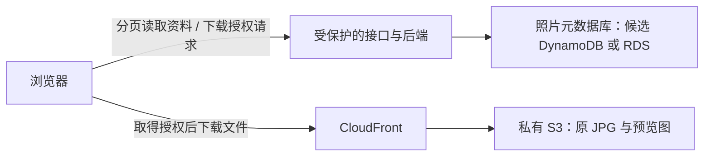

# 照片下载应用：可行性、扩展与费用评估

日期：2026-10-25（日本时间）。状态：评估资料，不是实施批准；未创建任何动态资源、上传照片或修改现有站点。

后续决定：本人已选择 DynamoDB，常规 RDS/Aurora 不进入首版实现。本文保留此前候选比较与费用假设；最新首版待定项和 GitHub 节点见 job-portfolio/docs/PHOTO_APP_PLAN.md。选型不代表应用已实现或批准自动部署。

## 本人最新要求与评估结论

- 本人希望先判断照片下载 App 是否值得作为云相关求职作品，再决定数据库和实现。此前助手先推进最小功能而未充分评价可行性，本次纠正顺序。
- 拟以几十张照片做微缩版，关注数据增长到几万、百万张时能否保留核心分发架构；百万张是设计与验证目标，不是立即上传或已验证的能力。
- 下载文件已明确为本人修图后、原尺寸的 JPG，不是相机 RAW，也不替换为当前 WebP 展示副本。预览仍可用缩略图，下载校验原文件一致性。
- 评估：适合作为云/基础设施方向的作品题材，价值来自权限、存储与元数据分离、分页与索引、文件分发、失败处理、费用与验证证据。题材和使用数据库本身不保证求职效果。
- 推荐候选为 S3 + CloudFront 文件分发、后端处理资料与授权、DynamoDB 保存元数据；RDS PostgreSQL 是合理备选，不因百万条记录就排除关系型数据库。用户尚未选型。

## 可延续的核心架构与扩展条件

后端不承担正常原图的逐字节转发。使用现有签名 Cookie 或设计签名 URL 路径，具体选择需结合现有 /* 邀请范围、文件权限和有效期。S3 预签名直连是另一种技术路径，但会改变现有仅指定 CloudFront 回源的权限与计费边界，不能直接混用或自动放开桶策略。

百万张图片可以继续用同一核心分工，但“核心架构相同”不等于“配置、索引、配额、并发和预算不变”。必须：

- 每次只读一页资料，例如 24 张；避免打开页面全表 Scan、遍历全部 S3 对象或下载全部原图。
- 预先明确按照片 ID、相册与排序查询，设计索引。DynamoDB 需均匀分配热点，不能将所有热门请求挤在一个固定键上；RDS 需评估索引、执行计划、连接与容量。
- 保留缩略图供浏览；点击下载才取原 JPG。对象数与下载并发是不同维度：百万张低访问库与数百张高并发库的瓶颈不同。
- 检查服务配额、限流、错误与重试；大量上传可增加后台处理队列，复杂检索可按需求加搜索组件，均非本轮自动实施范围。
- 小样本实测、合成元数据测试与真实百万规模压力测试分别记录。不能将 AWS 服务能力或小样本跑通写成应用已验证百万图片/百万并发。

## 实用下载方式的设计建议

| 使用场景 | 建议行为 |
| --- | --- |
| 找到一张照片 | 查看预览，授权后从 CloudFront/S3 保存原 JPG；可验证文件大小与哈希一致 |
| 下载挑选的数张或数十张 | 提供选择与总大小；可逐文件受控下载，或按总字节/数量限制创建 ZIP 任务 |
| 下载较大批次 | 创建异步任务，返回任务 ID；后台分批生成 ZIP 保存到 S3，完成后给受保护且有期限的下载入口；限制任务并发，过期清理产物 |
| 导出整个大型库 | 使用清单、分批任务及下载工具，处理重试与续传；不在一个网页请求里同步打包百万文件 |

库里有百万张不意味着每次要下载百万张。若真要导出百万张，按本报告假设约 13TB，需计算出口带宽、存储、任务时长与权限。JPG 已压缩，ZIP 的主要作用是打包；不能预期显著节省图片体积。Lambda 的普通执行有时长和资源限制，大打包任务需按实际规模选择执行环境，不默认用一个同步 Lambda 处理全部。

现有邀请允许获准浏览器读取 /*。若以后分级权限、隐藏照片或草稿，必须在文件/源站授权落实，不能只从数据库返回列表中删除。新接口也不能被源站直连绕过。生成下载链接不等于下载成功，需实际取回并验证文件。

## 价格来源与单价

2026-10-25 只读获取 AWS 官方公开价目表，不访问本人 AWS 账号。全部美元、税前，东京 ap-northeast-1；CloudFront 用日本边缘区示例。下载用户所在地影响 CDN 价格。

| 项目 | 官方单价与口径 |
| --- | --- |
| S3 Standard，最初 50TB 存储档 | $0.025 / 计费 GB·月，计算使用 GiB（2^30 字节） |
| S3 PUT/COPY/POST/LIST | $0.0047 / 1,000 次 |
| S3 GET 等 | $0.0037 / 10,000 次 |
| DynamoDB Standard 按需读取 | $0.1425 / 百万 RRU |
| DynamoDB Standard 按需写入 | $0.715 / 百万 WRU |
| DynamoDB Standard 存储 | 首 25GB 免费档；之后 $0.285 / GB·月；免费档按账号/区域共享使用，不给每个表另算一份 |
| RDS PostgreSQL db.t4g.micro，Single-AZ | $0.025 / 小时 |
| RDS PostgreSQL gp3，Single-AZ | $0.138 / GB·月 |
| CloudFront 按量出口 | 每月首 1TB 免费；日本下一个 9TB 为 $0.114/GB，再下一个 40TB 为 $0.089/GB；免费用量按账号共享，非每个分配各有一份 |
| CloudFront 按量请求 | 每月首 1,000 万 HTTP(S) 请求免费；日本后续 HTTPS $0.012/10,000 次 |

DynamoDB 的读取/写入单位不是网页点击数，取决于条目大小、一致性、事务与索引等。按需读取不能套用预置模式的免费 RCU/WCU。S3 向 CloudFront 传输免相应出口费，但 S3 请求费及 CloudFront 向访客出口仍各自计算。

官方目录发布日期：DynamoDB 2026-09-11；RDS 2026-10-20；S3 2026-10-15。本报告未保存整个大目录，以上为当次筛选出的单价摘录。以后部署前重新核价。

## 实际文件与测算假设

只统计现有已用于网页的五张原始 JPG 文件大小，未改动文件：共 64,773,953 字节，平均 12.955MB，范围 3.707～19.424MB（此处 MB 为十进制）。统计不代表未来所有照片大小相同，不表示本人已选择其余照片上传。

规模推算统一假设每张 13,000,000 字节；按字节转 GiB 后计算存储费用：

| 照片数 | 原 JPG 总量 | 仅 S3 Standard 原图存储/月 |
| --- | --- | --- |
| 50 | 约 0.65GB（0.605GiB） | $0.015，约 $0.02 |
| 10,000 | 约 130GB（121.072GiB） | $3.03 |
| 1,000,000 | 约 13TB（12,107.193GiB） | $302.68 |

此表不含缩略图、版本副本、临时 ZIP、请求、日志、备份与出口流量。不应用 S3 促销抵扣，展示正常计费量级。

每月下载流量另算。假设每次完整下载一张 13MB JPG、均在日本边缘区分发、账号没有其他 CloudFront 用量占用免费档：

| 每月完整下载次数 | 流量 GiB | 仅 CloudFront 出口/月 |
| --- | --- | --- |
| 1,000 | 12.107 | $0 |
| 100,000 | 1,210.719 | $21.32 |
| 1,000,000 | 12,107.193 | $1,216.79 |

此表不含预览流量、请求、重试与其他组件。缓存命中可减少 S3 回源，不能免掉向访客交付字节的 CDN 出口费。

## 数据库与 140 USD 抵扣金

历史账号反馈为免费计划剩余 177 天、余额 140 USD。本次未重新核对余额、准确期限、其他项目消耗或账号可创建的实例规格。

- DynamoDB 示例：一个月共消耗 100,000 RRU 和 1,000 WRU，读写约 $0.014965；元数据若在共享免费存储档内，其存储项为零。API/Lambda/日志等另算。
- RDS 示例：730 小时 × $0.025 + 20GB × $0.138 = $21.01/月。持续六个月基线为 $126.06。该 micro 是演示配置，不是百万图片高并发生产容量承诺。未含额外 CPU credits、超额备份、网络、密钥、Proxy、接口等；不加入 NAT Gateway、Multi-AZ 或公网 IPv4 作为默认前提。
- 对几十张原图、每月约千次下载与少量接口调用的演示，DynamoDB 整套方案先按 $1～5/月预留预算，这是保守预算而不是已测账单或硬上限。六个月预算 $6～30，若抵扣适用、账号仍可用且其他资源不消耗，140 USD 有较大余量。
- 相同轻量应用的 RDS 分支按数据库 $21.01 + 其余 $1～5，约 $22～26/月，六个月约 $132～156；相对 140 的算术差额约 $0～16。不能据此保证绝不超支，未核实其他项目与可用规格。
- 适用抵扣覆盖期间，现金支出可能为 $0，资源仍在消费额度；抵扣结束并转付费后，按实际用量承担费用。当前 Free plan 不会因消耗完就静默开始无限收费：官方规则为六个月或额度耗尽较早者结束，继续使用需本人选择升级付费。未升级则服务/资源访问中止，需提前安排求职站持续使用；本轮不升级账号。

## SQL 学习与数据库取舍

本人后续反馈：不喜欢 SQL，不希望这次作品以 SQL 或关系型数据库运维为重点，倾向不采用常规 RDS；询问 Aurora Serverless 的按使用付费是否值得考虑。因此此前“另安排 SQL 实验”不作为默认后续任务。助手建议 DynamoDB 为优先方向，但本人尚未最终选择。

## Aurora Serverless v2 补充比较（2026-10-25）

- 本次明确讨论兼容 PostgreSQL/MySQL 的 Aurora Serverless v2，不混用旧 v1 或 Aurora DSQL 的规则。它仍是关系型数据库，自动调整计算容量不免除表、SQL、索引和访问控制设计。
- 官方文档确认：兼容版本可把最低容量设置为 0 ACU，满足无用户连接等条件后自动暂停；暂停时不收实例计算容量费。自动暂停的空闲时间最短 300 秒。最低容量非零、连接未关闭或某些配置会阻止暂停；RDS Proxy 的持续连接会阻止此自动暂停。
- 计算按 ACU·秒计费，不是按执行 SQL 的毫秒数或查询条数计费。查询之后等待暂停的空闲期仍计入运行容量；持续连接/频繁访问可使计算一直收费。存储、标准模式 I/O 和其他适用费用在暂停后仍需单独考虑。
- 恢复典型约 15 秒，暂停超过 24 小时可能 30 秒或更久；应设计前端等待、连接超时与重试。该时间是文档典型描述，不是 SLA 或本项目实测。
- 东京官方公开目录（2026-10-20 发布，本次只读获取）：Aurora PostgreSQL Serverless v2 Standard 为 $0.15/ACU·小时；标准存储 $0.12/GB·月，I/O $0.24/百万次。I/O-Optimized 使用不同价格，不能套用本例。
- 仅计算费示例：假设运行期间平均 0.5 ACU，含空闲尾段的计费活跃时间每天共 1 小时、每月 30 天，计算费为 0.5 × 30 × 0.15 = $2.25/月；若 730 小时均维持 0.5 ACU，则 $54.75/月。另有 10GB 计费存储时再加 $1.20/月及 I/O 等。例子不是最低配置保证或整套应用报价；实际容量、暂停与账号可用性未核实。
- 取舍：有明确 SQL/关系需求、长时间闲置且可接受唤醒等待时值得考虑；本项目尚无必须 SQL 的查询要求，本人又不希望重点学习 SQL，因此不为“Serverless”名称而增加 Aurora。仍优先建议评估 DynamoDB，尚未创建资源或升级账号。

补充官方来源：

- 自动暂停、连接限制与恢复：https://docs.aws.amazon.com/AmazonRDS/latest/AuroraUserGuide/aurora-serverless-v2-auto-pause.html
- 版本与容量条件：https://docs.aws.amazon.com/AmazonRDS/latest/AuroraUserGuide/aurora-serverless-v2.requirements.html
- Aurora 计费：https://aws.amazon.com/rds/aurora/pricing/
- 东京精确单价沿用上文 AmazonRDS 官方区域目录。

## SQL 学习价值的历史比较（不作为当前学习任务）

SQL 对涉及 RDS、数据库运维、排错、数据查询的云岗位有实际价值，包括查询、索引、权限、备份恢复和连接排查。云岗位覆盖面很广，不能把某一种数据库或 SQL 的使用自动等同于求职优势。应按目标职位要求和本人能够说明的验证结果展示。

- DynamoDB 分支：更容易将低流量在线作品维持在较低费用，突出无服务器、IAM、访问模式与分页。按百万数据思考主键、索引、热点和配额，仍需测试。
- PostgreSQL/RDS 分支：照片、相册、标签等关系可形成真实 SQL 场景，突出关系设计、查询计划、私有网络、连接与恢复；长期运行有固定费用。
- 若优先控制在线作品成本，可先将 DynamoDB 作为候选，并另外安排本地 PostgreSQL 或短期 RDS 实验来练 SQL。该分工作为建议，不是本人已选择，也不默认把第二个数据库加入应用。

## 下一步与验证边界

先由本人评估题材是否符合求职目标，以及愿意承担的运行预算，再选数据库和下载形式。不要立即追问按钮细节、创建空资源或把草案当成已批准实现。后续可准备两套相同功能的数据与费用方案供比较。

建议验证分层：几十张原 JPG 的真实浏览/授权/下载/完整性；较大量合成元数据下的分页与查询；限定请求量的测试和费用观察。真实百万文件或高并发测试另行说明预算和范围，未经测试只称“面向扩展的设计”。本人理解程度依据其反馈记录。

## 官方来源

- S3 东京公开目录：https://pricing.us-east-1.amazonaws.com/offers/v1.0/aws/AmazonS3/current/ap-northeast-1/index.json
- DynamoDB 东京公开目录：https://pricing.us-east-1.amazonaws.com/offers/v1.0/aws/AmazonDynamoDB/current/ap-northeast-1/index.json
- RDS 东京公开目录：https://pricing.us-east-1.amazonaws.com/offers/v1.0/aws/AmazonRDS/current/ap-northeast-1/index.json
- CloudFront 按量费用：https://aws.amazon.com/cloudfront/pricing/pay-as-you-go/
- 免费计划及期限：https://aws.amazon.com/free/free-tier-faqs/
- DynamoDB 容量与价格：https://aws.amazon.com/dynamodb/pricing/
- RDS PostgreSQL 价格与额外 CPU 费用：https://aws.amazon.com/rds/postgresql/pricing/
- S3 扩展：https://docs.aws.amazon.com/AmazonS3/latest/userguide/optimizing-performance.html
- DynamoDB 分页：https://docs.aws.amazon.com/amazondynamodb/latest/developerguide/Query.Pagination.html
- DynamoDB 分区键：https://docs.aws.amazon.com/amazondynamodb/latest/developerguide/bp-partition-key-design.html
- CloudFront 分段读取：https://docs.aws.amazon.com/AmazonCloudFront/latest/DeveloperGuide/RangeGETs.html
- Lambda 限制：https://docs.aws.amazon.com/lambda/latest/dg/gettingstarted-limits.html
