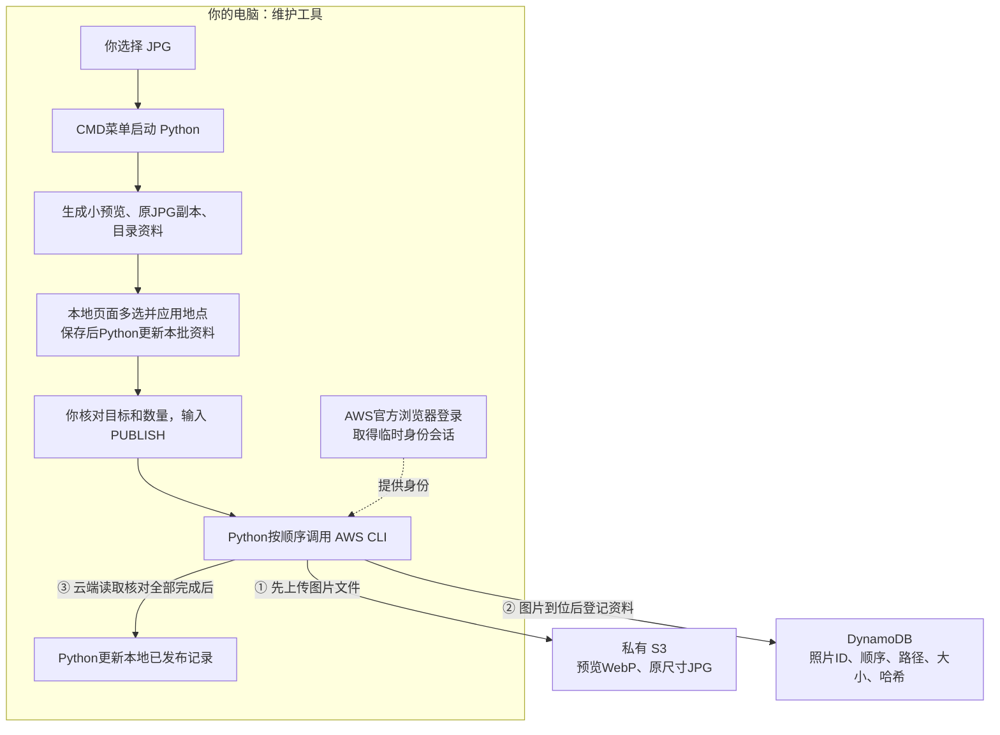
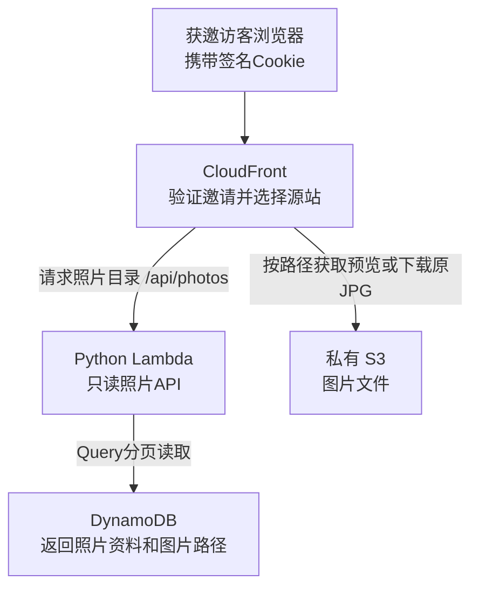

# 照片维护工具与AWS：实际设计说明

更新：2026-11-01。依据现有代码、本人真实发布反馈和本地发布回执整理；不是未来功能设想。CMD仍为维护入口，已加入本地看图批量选地点。83张新照片已由本人确认发布，166个图片文件/83条照片资料（另有地点查询副本），相册共92张、九地点；总列表真实四页为24/24/24/20。本批15项线上只读检查通过，不据此声称百万级性能或全部代码独立手写。

新增看图界面复用原准备和发布主干：HTML/CSS显示预览与控件，JavaScript记录多选结果并把“照片ID→地点”发给本机Python；photo_location_picker.py提供本地页面和保存清单，photo_new_batch.py在地点齐全后把结果同步到本批catalog、选择清单、导入资料和候选基准。菜单5继续由photo_publish.py调用AWS CLI。地点是本人判断和选择的，程序没有识图猜地点；代码由AI协助实现，不将界面操作等同于本人独立手写全部代码。

这不是CMD本身拥有云能力，而是CMD启动Python程序，Python调用AWS官方CLI。CLI使用本人通过官方浏览器登录取得的临时身份会话，向AWS发送请求；AWS按该IAM身份的权限决定是否执行。它把之前控制台上传图片、CloudShell登记资料、核对结果的手顺串在一起。

准备和发布主干有三份主要Python文件：photo_maintenance.py是菜单/调度入口，prepare_photos.py是准备模块，photo_publish.py是发布模块；入口把另外两份作为模块调用。新增看图/地点模块在上段说明。准备模块内部还复用Node.js脚本整理目录JSON。发布回执和已发布快照也由photo_publish.py写入，没有另一个专门写日志的第三工具。

输入PUBLISH只确认云端写入：生成预览/副本/资料在菜单2已经完成；菜单5输入PUBLISH前也会先只读核对身份/目标。publish-result.json是本批回执，published-catalog.json是目录快照，不能笼统当成同一种日志，也不是CloudWatch日志。

## 1. 本人发布照片

箭头中的①②③是实际执行次序，不是同时执行三个独立任务。发布请求由本机CLI直接发给S3和DynamoDB，不经过网站CloudFront或照片Lambda。

1. **准备：**Python读取选定目录，根据文件内容计算SHA256“指纹”，与本地已发布快照比较，跳过已记录原图；生成新图的WebP和原JPG逐字节副本、目录资料。这一步不联网。
2. **核对身份和目标：**菜单5先只读取得当前IAM身份，核对固定账号、东京区域、原桶、原表及末尾位置，检查本批云端同名/同键内容。此时尚未写云端。
3. **由本人发起：**显示目标和待处理数量，本人输入PUBLISH才开始。CLI使用登录会话签署请求；程序不需要知道本人密码，也没有把账号密码写进脚本。
4. **先传文件：**向S3放入预览与原JPG。使用完整SHA256校验、条件写入，拒绝覆盖不同内容。已有同内容文件可复用。
5. **再登记资料：**向DynamoDB写入照片目录。资料保存图片位置，不保存图片二进制。条件PutItem拒绝替换已有不同资料，避免误覆盖。
6. **最后核对并记账：**读取云端对象校验信息及一致性目录资料；缺少完整SHA256时读取文件核对。全部完成才更新本地published-catalog.json和published-state.json。本批结果在publish-result.json。部分失败保留已完成项，重试同批会再读云端状态；不会自动删除对象或把未完成批次标成成功。

本地“跳过已发布照片”不是实时AWS查询。它只说明文件指纹已在本地快照中；真正发布时才读取云端。如果云端被另外修改，本地可能过时，所以入口会检查目标和末尾位置，并在不一致时停止。当前工具按一个维护者新增设计，不支持多人同时维护同一批顺序。

## 2. 访客浏览和下载

这张图画请求方向。浏览器先取得目录中的图片地址，再按地址请求图片。Lambda读取目录并返回JSON，图片内容由CloudFront从S3取得；正常原图下载不让文件经过Lambda或数据库。

- **S3：**保存真正的图片文件。
- **DynamoDB：**保存照片目录，告诉网页每张图在哪里、显示顺序是什么。
- **Lambda：**从DynamoDB按页取资料，给网页提供接口。
- **CloudFront：**处理访客邀请校验、路由和图片分发。

本人维护工具使用的IAM临时身份，与访客浏览用的签名Cookie是不同授权。浏览邀请不提供上传、写数据库或管理AWS的能力。临时会话由AWS CLI管理；本地发布记录也不是登录凭证。

## 3. 本次真实例子：8张变9张

本人通过统一入口新增1张，回执记录：上传2个文件、登记1条目录资料、status=verified；已发布快照更新为9条。本人随后确认线上相册有9张。

- 2个文件：这张照片的预览WebP和原JPG副本。
- 1条资料：照片ID/顺序9/两种文件路径/大小/哈希。
- 8→9：数据库新增目录条目，网页再次读取API时得到新条目；网页代码无需为每张照片修改。

证据位于忽略目录.local/photo-app/batches/20261029-111832-49bf4be5/publish-result.json及.local/photo-app/published-state.json。本次证明一个真实新增批次可完成，不是百万规模或多人并发测试，也不把AI协助实现等同本人已理解全部代码。

## 4. 当前讲解重点

先理解两条路径和一次授权：本人发布走本机CLI→S3/DynamoDB，访客访问走CloudFront→Lambda/DynamoDB或S3；AWS资源按维护者IAM身份授权，访客按邀请读取。

可以这样概述：我把照片文件与目录资料分开保存，文件放在私有S3、目录放在DynamoDB。访客通过CloudFront和只读Lambda浏览；维护时使用本机工具，确认后按顺序上传图片、登记目录并核对。代码由AI协助实现，我通过实际操作和反馈核对功能，并继续理解服务分工、权限和失败处理。

CMD只是操作入口，是否美观不改变上述AWS链路。本人已明确当前界面够用，保留现状；后续不为视觉增加界面开发。
